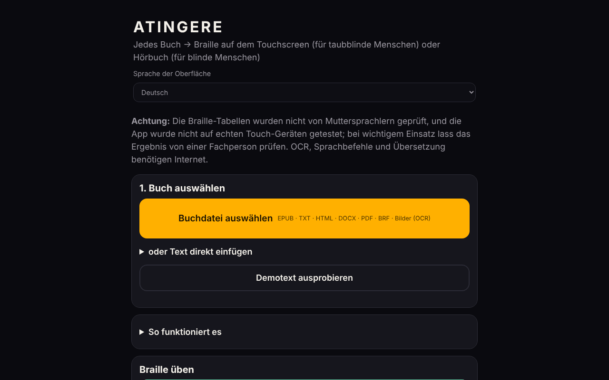

# ATINGERE

[English](README.md) · [Română](README.ro.md) · [Français](README.fr.md) · [Italiano](README.it.md) · [Español](README.es.md) · [Português](README.pt.md) · **Deutsch** · [Magyar](README.hu.md)

**Version:** 1.3.0 · **Zuletzt aktualisiert:** 2026-10-27

**Status:** experimentell · **Offline:** vollständig für die Grundfunktionen; benötigt Internet für OCR-Sprachdaten, Sprachbefehle und automatische Übersetzung

Oberflächensprachen: **Română, English, Français, Italiano, Español, Português (PT), Deutsch, Magyar**

**Live / Demo:** https://chiuta.github.io/ATINGERE/

Wandelt jedes Buch (EPUB, TXT, HTML, DOCX, PDF, BRF, Bilder) in taktile Braille-Schrift für taubblinde Menschen oder in ein Hörbuch für blinde Menschen um. Eine einzige HTML-Datei, 137 Sprachen und Codes (Braille Grad 1); die Funktionen OCR, Sprachbefehle und Übersetzung benötigen Internet.

**Jedes Buch, als taktile Braille-Schrift oder als Hörbuch — aus einer einzigen HTML-Datei, ohne Konto, ohne Server.**

*Eigenständige Offline-Web-App, die ein Buch in Braille auf dem Touchscreen (Vibration, für taubblinde Leserinnen und Leser) oder in ein TTS-Hörbuch (für blinde Leserinnen und Leser) verwandelt. Über 130 Sprachen, Rumänisch zuerst.*

**Live-App:** derzeit gibt es keine bestätigte öffentliche Adresse (GitHub Pages ist nicht aktiviert oder die Adresse wurde beim Audit nicht überprüft). Lade `index.html` herunter und öffne sie in einem Browser; die Grundfunktionen laufen offline.

## Für wen
- **Taubblinde Menschen:** Das Buch wird auf dem Touchscreen zu Braille. Jede Zelle hat 6 Punkte; die erhabenen Punkte spürt man als Vibration unter dem Finger. Es gibt außerdem automatische Vibrationen im Rhythmus der Zellen.
- **Blinde Menschen:** Das Buch wird mit der Sprachsynthese des Geräts zu einem Hörbuch, mit automatischer Wiederaufnahme, einstellbarer Geschwindigkeit und Einschlaf-Timer.

## Was es kann
- **Eingabeformate:** EPUB, TXT, HTML, DOCX, PDF (mit Text, offline), BRF/BRL und Unicode-Brailletexte, gescannte PDFs und PNG/JPG/WebP-Bilder (per OCR).
- **Braille:** über 130 Sprachen; erweitertes Rumänisch mit eigenem Code. Grad 1 für alle, **Grad 2** für 10 Sprachen (en, fr, de, pt, no, da, hu, ga, cy, ur) über liblouis.
- **Taktiles Lesen:** Zelle, Wort, Absatz, Kapitel; zwei benachbarte Zellen; Lernmodus mit Tests; Perkins-Schreiben.
- **Werkzeuge:** Lesezeichen, Suche, Absatzwiederholung, lokale extraktive Zusammenfassung, Lehrerseite (Text + Braille, mit Druckschaltfläche und eigenem Druckstil), Notstopp (Schütteln, Esc), hoher Kontrast, vergrößerter Text, Sprachbefehle (auf Rumänisch).
- **Export:** `.brf` (40 × 25) und Unicode-Brailletext.
- **Katalog:** kostenlose Buchquellen auf Rumänisch und in anderen Sprachen sowie Quellen für Bücher, die bereits in Braille vorliegen.
- **Automatische Übersetzung** ins Rumänische (optional, Modell wird einmal heruntergeladen, ~700 MB).

## Was Internet braucht
OCR (die Sprachdaten werden einmal heruntergeladen; die Engine ist enthalten), Sprachbefehle (der Dienst des Browsers) und die automatische Übersetzung. Alles andere funktioniert offline.

## Grenzen — vor ernsthafter Nutzung lesen
(Der folgende Hinweis wird auch auf dem ersten Bildschirm der App angezeigt.)
- Die Brailletabellen **wurden nicht von muttersprachlichen Braille-Leserinnen und -Lesern validiert**, und die App **wurde nicht auf echten Touchgeräten** (Vibration, Bildschirm) oder mit Screenreadern getestet. Die automatischen Tests prüfen die Konsistenz, nicht, ob der Text für die Leserin oder den Leser richtig ist.
- Für Chinesisch, Kantonesisch, Japanisch und Koreanisch wird die Brailleschrift näherungsweise aus der Aussprache gewonnen; manche Lesungen können falsch sein.
- Grad 2 stammt aus liblouis 3.2.0 (alte Tabellen). Für Rumänisch gibt es keinen standardisierten Grad 2; es wird Grad 1 verwendet.
- iPhone/iPad erlauben keine Vibration aus dem Browser. Nutze Android + Chrome oder exportiere `.brf`.
- Sprachbefehle und OCR wurden mit Simulationen geprüft, nicht mit echter Stimme oder echten Scans über das Internet.
- Nicht implementiert: Hardware-Braillezeile (WebHID), neuronale Offline-Stimme, installierbare App (PWA).

## Fehlermeldungen
Wenn ein Wort mit falscher Brailleschrift erscheint, nutze in der App **⋯ → Braille-Fehler melden** und hänge die Datei dann an ein *Issue* an. Am nützlichsten ist die Meldung einer muttersprachlichen Braille-Leserin bzw. eines Braille-Lesers mit Sprache, Wort und korrekter Form.

## Datenschutz
Die App hat keinen eigenen Server, kein Konto, keine Statistik und kein Tracking; die Bücher bleiben im Browser, Fortschritt und Lesezeichen werden lokal gespeichert. **Einige optionale Funktionen kontaktieren jedoch Dritte:**
- **OCR** (Bilder/gescanntes PDF): Die Engine (`tesseract.js`) ist Teil des Repositorys (`vendor/`, mit SRI geladen); bei der ersten Nutzung einer Sprache werden deren Daten von `raw.githubusercontent.com` geladen (fester Commit, SHA-256 vor der Verwendung geprüft); dieser Server sieht die IP-Adresse, nicht den Text des Buches.
- **Automatische Übersetzung** (optional): Die Bibliothek (`transformers.js`) liegt in `vendor/`; das `.wasm` von ONNX Runtime (~22 MB) wird von einem exakten Pfad auf `cdn.jsdelivr.net` geladen (feste Version, SHA-256 geprüft, sonst abgelehnt) und das Modell (~700 MB) von `huggingface.co`; die Übersetzung läuft lokal.
- **Sprachbefehle**: Sie nutzen die Spracherkennung des Browsers (`SpeechRecognition`); in Chrome zum Beispiel wird das Audio an den Sprachdienst des Browseranbieters gesendet.
- Die Links im Buchkatalog führen nur per Klick zu externen Websites.
Ohne diese Funktionen stellt die App keine Netzwerkanfragen.

## Lizenz
Eigener Code: MIT (siehe [LICENSE](LICENSE)). Die Drittanbieter-Komponenten (liblouis, pdf.js und andere) haben eigene Lizenzen; siehe [NOTICE.md](NOTICE.md). Einige Einträge dort sind als „zu prüfen“ markiert (die aus pykakasi abgeleitete Kanji-Tabelle, möglicherweise GPL-3.0; die Chinesisch-/Kantonesisch-Tabellen mit undokumentierter Quelle; das Modell NLLB-200, CC-BY-NC, auf Anfrage heruntergeladen) und müssen vom Autor geklärt werden, bevor die MIT-Lizenz als endgültig gilt.

**Lizenzstatus (in Klärung).** Die Tabelle Kanji → Hiragana (Japanisch) ist von pykakasi (GPL-3.0) abgeleitet, und die Quelle der Pinyin- (Chinesisch) und Jyutping-Tabellen (Kantonesisch) ist nicht dokumentiert; die Vereinbarkeit mit der MIT-Lizenz ist noch nicht geklärt, und **die Lizenz wurde nicht geändert**. Bis dahin lassen sich diese Tabellen in den Einstellungen deaktivieren (der Rest der App, einschließlich Kana und Hangul, bleibt unberührt). Optionen für den Autor: (1) das gesamte Projekt unter GPL-3.0 stellen; (2) die Tabellen durch permissive oder gemeinfreie Daten ersetzen (z. B. CC0 / aus Unicode Unihan abgeleitet, mit dokumentierter Quelle); (3) die betroffenen Sprachen entfernen.

Audit: 2026-10-10; Runde 2 (2026-10-11): Validierungshinweis auf dem ersten Bildschirm; die MIT-Lizenz und NOTICE.md bleiben unverändert (die Konflikte pykakasi/GPL, liblouis/LGPL und NLLB/CC-BY-NC müssen weiterhin vom Autor geklärt werden); SRI für die jsDelivr-Skripte konnte nicht hinzugefügt werden (kein Netzwerk zur Berechnung der Hashes).

## Neue Funktionen (v1.1.0)

- **Transparenzlabel** (Klick auf `v 1.1.0 · 2026-10-14` in der Fußzeile, gemeinsames Kit): zeigt, welchen lokalen Speicher die App verwendet (Fortschritt, Lesezeichen, Einstellungen) und dass die Grundfunktionen keine Netzwerkanfragen stellen.
- **`.fff.json`-Sicherung** von Lesefortschritt, Lesezeichen und Einstellungen (Export/Import, optional mit Passwort verschlüsselt; die Bücher selbst sind nicht enthalten).
- **Braille-Umwandlung, taktiles Lesen und Hörbuch sind unverändert**: Gegenüber 1.0.0 wurden nur der Kit-Block und die Version hinzugefügt. Die CSP wurde nicht verändert (sie bleibt ohne `script-src`, aus den im Verlauf genannten Gründen). Es wurde nichts hinzugefügt, das die Brailletabellen berührt.
- Die neuen Texte liegen in ro, en, fr, it, es, pt, hu, de vor; die Übersetzungen sind maschinell erstellt und nicht von Muttersprachlern geprüft.
- Tests: `tests/fff-r8.test.mjs` (Netzwerk blockiert, 1280 und 360 px, axe 0 Verstöße im neuen Dialog). Einschränkung: Die App wurde wie zuvor nicht auf echten Touchgeräten getestet.

## Verlauf / Changelog

### 1.2.7 — 2026-10-22
- Sicherheit: Zur Laufzeit wird kein Code mehr von einem CDN geladen. `tesseract.js` 5.1.1 (mit `tesseract.js-core` 5.1.0, SIMD-Build) und `transformers.js` 3.8.1 liegen jetzt in `vendor/` (von derselben Origin mit SRI geladen und vom Service Worker vorab gecacht). Die OCR-Sprachdaten stammen von einem festen `tessdata_fast`-Commit und das `.wasm` von ONNX Runtime von einem festen npm-Pfad; beide werden vor der Nutzung per SHA-256 geprüft (sonst abgelehnt). CSP: `cdn.jsdelivr.net` aus `script-src` entfernt, `connect-src` auf exakte Pfade begrenzt. Rund 5 MB zum Repository hinzugefügt (siehe `NOTICE.md`).
- OCR benötigt WebAssembly SIMD; von `file://` lassen sich die OCR- und Übersetzungsbibliotheken nicht laden (https oder lokalen Server verwenden).

### 1.2.6 — 2026-10-22
- fff-kit 1.1.4: Touch-Ziele und Mindestschriftgröße; Touch-Ziele/Text korrigiert

### 1.2.5 — 2026-10-22
- Sicherheit: vollständige Content-Security-Policy (`default-src 'none'`; Skripte nur per Hash und von `cdn.jsdelivr.net`; Verbindungen nur zu `cdn.jsdelivr.net`, `raw.githubusercontent.com` und `huggingface.co`/`hf.co`). Bestehen bleiben `'unsafe-eval'` (für liblouis, Stufe 2) und `blob:` (für das eingebettete pdf.js). Geprüft: Stufe 2, PDF, OCR und Blockieren nicht gelisteter Hosts.
- Transparenz: die deklarierten externen Hosts entsprechen jetzt den tatsächlichen (es fehlten `raw.githubusercontent.com` für die OCR-Sprachdaten und `huggingface.co` für das Übersetzungsmodell).
- Lizenzen: neue Option in den Einstellungen, die die Lesetabellen für Chinesisch, Kantonesisch und Japanisch (Kanji) deaktiviert, sowie ein Hinweis „Lizenzen und rechtlicher Stand“ in der App (in 8 Sprachen übersetzt). Stand: **in Klärung** durch den Autor, siehe unten.

### 1.2.4 — 2026-10-22
- fff-kit 1.1.2: PBKDF2 mit 600.000 Iterationen, Schutz vor Clickjacking

### 1.2.3 — 2026-10-22
- Barrierefreiheit: genau eine H1 pro Ansicht (die übrigen Titel sind H2 mit gleichem Aussehen); das Feld zum Einfügen des Textes hat jetzt einen zugänglichen Namen.
- Der Schritt „Braille-Fehler melden“ nutzt keinen blockierenden Browser-Prompt mehr: Es öffnet sich ein Dialog in der App (in alle 8 Sprachen übersetzt).
- Mobil: kleine Beschriftungen haben mindestens 12 px; Links in den Quellenlisten haben eine größere Tippfläche.

### 1.2.2 — 2026-10-22
- die doppelte englische Validierungshinweis-Box in der rumänischen Oberfläche wurde entfernt (der rumänische Hinweis sagt bereits dasselbe).

### 1.2.1 — 2026-10-22
- Der Katalog der Buchquellen (Namen, Preishinweise und Beschreibungen) und der Seitentitel folgen jetzt der Oberflächensprache, statt rumänisch zu bleiben.

### 1.1.1 — 2026-10-18
- Behoben: Die Spracherkennung stimmt nicht mehr bei jedem Mittelpunkt „·“ (in Titeln verwendet, z. B. Nota Zero) für Katalanisch; es bleibt nur die Geminate „l·l“. Rumänische .md-Dateien mit „·“ werden jetzt als `ro` erkannt.

### 1.1.0 — 2026-10-14
- Neu: Transparenzlabel und `.fff.json`-Sicherung (gemeinsames Kit). Braille-Umwandlung unverändert.

### 1.0.0 — 2026-10-12
- Version und Datum der letzten Aktualisierung werden in der App angezeigt (Fußzeile).

### 11. Oktober 2026 (Runde 7)
- Behoben: Der .BRF/.txt-Export fängt jetzt Fehler ab (Meldung „Export fehlgeschlagen“ statt eines stillen Fehlschlags) und deaktiviert die Schaltflächen, solange er läuft, damit nicht zwei Downloads gleichzeitig starten; ein Download-Fehler ließ sich in Chromium nicht reproduzieren (Downloads funktionieren), die gemeldete Ursache bleibt daher unbestätigt.
- Verbessert: Der Hinweis auf dem ersten Bildschirm ist auf Rumänisch kurz, mit der englischen Fassung (mit `lang="en"` markiert) in einem „English“-Panel; Hinweis zur ASCII-Braille-Kodierung des .BRF-Exports.
- Unverändert: kein `script-src` in der CSP und kein SRI (liblouis/`new Function`, Worker und WASM von jsDelivr; ohne Netzwerk nicht prüfbar); die Lizenzen bleiben Entscheidung des Autors.

### 11. Oktober 2026 (Runde 6)
- Hinzugefügt: Schaltfläche „Drucken“ auf der Lehrerseite, mit einem Druckstil, der nur das Braille und den Absatztext behält; berücksichtigt `prefers-reduced-motion` und `prefers-contrast: more`.
- Unverändert: kein `script-src` in der CSP (es bräuchte `unsafe-eval` für liblouis, Worker/WASM von jsDelivr für OCR und Übersetzung, ohne Netzwerk nicht prüfbar).

### 11. Oktober 2026
- Behoben: Die Exportschaltflächen (.BRF und Unicode-Brailletext) sind jetzt direkt auf dem Hauptbildschirm sichtbar (Schritt 3), nicht in einem eingeklappten Abschnitt.
- Behoben: Das Sprachsuchfeld hatte einen weißen Hintergrund mit hellem Text (unzureichender Kontrast); die Bildschirme Braille, Audio, Lernen und Schreiben haben jetzt eine Überschrift der Ebene 1 (0 axe-core-Verstöße bei 1280 und 360 px, auch nach dem Laden eines Textes).
- Unverändert (Entscheidung des Autors): Die Lizenzen der Komponenten pykakasi/NLLB/liblouis müssen weiterhin geklärt werden; `new Function` (Laden von liblouis) bleibt erhalten, nötig für Braille Grad 2.
