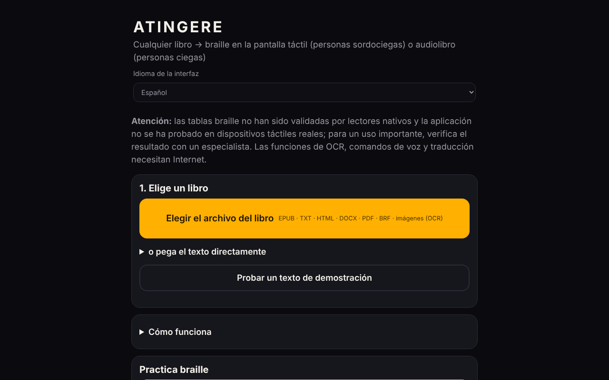

# ATINGERE

[English](README.md) · [Română](README.ro.md) · [Français](README.fr.md) · [Italiano](README.it.md) · **Español** · [Português](README.pt.md) · [Deutsch](README.de.md) · [Magyar](README.hu.md)

**Versión:** 1.2.0 · **Última actualización:** 2026-10-19

Idiomas de la interfaz: **Română, English, Français, Italiano, Español, Português (PT), Deutsch, Magyar**

**En línea / demo:** https://chiuta.github.io/ATINGERE/

Convierte cualquier libro (EPUB, TXT, HTML, DOCX, PDF, BRF, imágenes) en braille táctil para personas sordociegas o en audiolibro para personas ciegas. Un solo archivo HTML, 137 idiomas y códigos (braille de grado 1); las funciones de OCR, comandos de voz y traducción necesitan internet.

**Cualquier libro, en braille táctil o en audiolibro — desde un solo archivo HTML, sin cuenta, sin servidor.**

*Aplicación web autónoma y sin conexión que convierte un libro en braille en pantalla táctil (vibración, para lectores sordociegos) o en audiolibro con síntesis de voz (para lectores ciegos). Más de 130 idiomas, el rumano primero.*

**Aplicación en línea:** por ahora no existe una dirección pública confirmada (GitHub Pages no está activado o la dirección no se verificó en la auditoría). Descarga `index.html` y ábrelo en un navegador; las funciones básicas funcionan sin conexión.

## Para quién
- **Personas sordociegas:** el libro se convierte en braille en la pantalla táctil. Cada celda tiene 6 puntos; los puntos en relieve se notan como vibración bajo el dedo. También hay vibraciones automáticas, al ritmo de las celdas.
- **Personas ciegas:** el libro se convierte en audiolibro con la síntesis de voz del dispositivo, con reanudación automática, velocidad ajustable y temporizador de sueño.

## Qué hace
- **Formatos de entrada:** EPUB, TXT, HTML, DOCX, PDF (con texto, sin conexión), BRF/BRL y textos braille Unicode, PDF escaneados e imágenes PNG/JPG/WebP (mediante OCR).
- **Braille:** más de 130 idiomas; rumano ampliado, con código propio. Grado 1 para todos, **grado 2** para 10 idiomas (en, fr, de, pt, no, da, hu, ga, cy, ur) mediante liblouis.
- **Lectura táctil:** celda, palabra, párrafo, capítulo; dos celdas contiguas; modo de aprendizaje con pruebas; escritura Perkins.
- **Herramientas:** marcadores, búsqueda, repetición del párrafo, resumen extractivo local, página del docente (texto + braille, con botón de impresión y estilo de impresión propio), parada de emergencia (sacudida, Esc), alto contraste, texto ampliado, comandos de voz (en rumano).
- **Exportación:** `.brf` (40 × 25) y texto braille Unicode.
- **Catálogo:** fuentes gratuitas de libros en rumano y en otros idiomas, además de fuentes de libros ya en braille.
- **Traducción automática** al rumano (opcional, modelo descargado una vez, ~700 MB).

## Qué necesita internet
El OCR (el motor y los datos del idioma se descargan una vez), los comandos de voz (el servicio del navegador) y la traducción automática. Todo lo demás funciona sin conexión.

## Límites — lee antes de un uso serio
(La advertencia de abajo se muestra también en la primera pantalla de la aplicación.)
- Las tablas braille **no han sido validadas por lectores nativos de braille** y la aplicación **no se ha probado en dispositivos táctiles reales** (vibraciones, pantalla) ni con lectores de pantalla. Las pruebas automáticas verifican la coherencia, no que el texto sea correcto para el lector.
- Para chino, cantonés, japonés y coreano el braille se obtiene de forma aproximada, a partir de la pronunciación; algunas lecturas pueden ser erróneas.
- El grado 2 procede de liblouis 3.2.0 (tablas antiguas). Para el rumano no existe un grado 2 normalizado; se usa el grado 1.
- iPhone/iPad no permiten vibraciones desde el navegador. Usa Android + Chrome o exporta a `.brf`.
- Los comandos de voz y el OCR se verificaron con simulaciones, no con voz o escaneos reales por internet.
- No implementado: pantalla braille de hardware (WebHID), voz neuronal sin conexión, aplicación instalable (PWA).

## Informes de errores
Si una palabra aparece con braille erróneo, usa en la aplicación **⋯ → Informar de un error de braille** y luego adjunta el archivo a una *Issue*. Lo más útil es el informe de un lector nativo de braille, con el idioma, la palabra y la forma correcta.

## Privacidad
La aplicación no tiene servidor propio, cuenta, estadísticas ni seguimiento; los libros permanecen en el navegador, y el progreso y los marcadores se guardan localmente. **Pero algunas funciones opcionales contactan con terceros:**
- **OCR** (imágenes/PDF escaneado): en el primer uso carga `tesseract.js` desde `cdn.jsdelivr.net` (sin comprobación de integridad SRI) y los datos del idioma desde `raw.githubusercontent.com`; esos servidores ven la dirección IP, no el texto del libro.
- **Traducción automática** (opcional): carga `transformers.js` desde `cdn.jsdelivr.net` y el modelo (~700 MB) desde `huggingface.co`; la traducción se ejecuta localmente.
- **Comandos de voz**: usan el reconocimiento de voz del navegador (`SpeechRecognition`); en Chrome, por ejemplo, el audio se envía al servicio de voz del proveedor del navegador.
- Los enlaces del catálogo de libros llevan a sitios externos, solo al hacer clic.
Sin estas funciones, la aplicación no realiza peticiones de red.

## Licencia
Código propio: MIT (consulta [LICENSE](LICENSE)). Los componentes de terceros (liblouis, pdf.js y otros) tienen licencias propias; consulta [NOTICE.md](NOTICE.md). Algunas entradas allí están marcadas «por verificar» (la tabla de kanji derivada de pykakasi, posiblemente GPL-3.0; las tablas de chino/cantonés con fuente no documentada; el modelo NLLB-200, CC-BY-NC, descargado bajo demanda) y el autor debe aclararlas antes de que la licencia MIT se considere definitiva.

Auditoría: 2026-10-10; ronda 2 (2026-10-11): aviso de validación en la primera pantalla; la licencia MIT y NOTICE.md se mantienen sin cambios (los conflictos pykakasi/GPL, liblouis/LGPL y NLLB/CC-BY-NC siguen pendientes de aclarar por el autor); no se pudo añadir SRI a los scripts de jsDelivr (sin red para calcular los hashes).

## Novedades (v1.1.0)

- **Etiqueta de transparencia** (clic en `v 1.1.0 · 2026-10-14` del pie de página, kit común): muestra qué almacenamiento local usa la aplicación (progreso, marcadores, ajustes) y que las funciones básicas no realizan peticiones de red.
- **Copia de seguridad `.fff.json`** del progreso de lectura, los marcadores y los ajustes (exportación/importación, opcionalmente cifrada con contraseña; los libros en sí no se incluyen).
- **La conversión a braille, la lectura táctil y el audiolibro no cambian**: respecto a la 1.0.0 solo se añadieron el bloque del kit y la versión. La CSP no se modificó (sigue sin `script-src`, por los motivos del historial). No se añadió nada que afecte a las tablas braille.
- Los textos nuevos están en ro, en, fr, it, es, pt, hu, de; las traducciones son automáticas y no están verificadas por hablantes nativos.
- Pruebas: `tests/fff-r8.test.mjs` (red bloqueada, 1280 y 360 px, axe 0 violaciones en el nuevo diálogo). Limitación: la aplicación no se ha probado en dispositivos táctiles reales, como antes.

## Historial / Changelog

### 1.1.1 — 2026-10-18
- Corregido: la detección de idioma ya no vota catalán por cualquier punto medio «·» (usado en títulos, p. ej. Nota Zero); solo queda la geminada «l·l». Los archivos .md rumanos con «·» se reconocen ahora como `ro`.

### 1.1.0 — 2026-10-14
- Nuevo: etiqueta de transparencia y copia de seguridad `.fff.json` (kit común). Conversión a braille sin cambios.

### 1.0.0 — 2026-10-12
- La versión y la fecha de la última actualización se muestran en la aplicación (pie de página).

### 11 de octubre de 2026 (ronda 7)
- Corregido: la exportación .BRF/.txt ahora captura los errores (mensaje «La exportación falló» en lugar de un fallo silencioso) y desactiva los botones mientras se ejecuta, para no iniciar dos descargas a la vez; no se pudo reproducir un fallo de descarga en Chromium (las descargas funcionan), por lo que la causa notificada sigue sin confirmarse.
- Mejorado: la advertencia de la primera pantalla es breve en rumano, con la versión en inglés (marcada `lang="en"`) en un panel «English»; nota sobre la codificación ASCII braille de la exportación .BRF.
- Sin cambios: sin `script-src` en la CSP y sin SRI (liblouis/`new Function`, workers y WASM desde jsDelivr; no se pueden verificar sin red); las licencias siguen siendo decisión del autor.

### 11 de octubre de 2026 (ronda 6)
- Añadido: botón «Imprimir» en la página del docente, con un estilo de impresión que conserva solo el braille y el texto del párrafo; respeta `prefers-reduced-motion` y `prefers-contrast: more`.
- Sin cambios: sin `script-src` en la CSP (requeriría `unsafe-eval` para liblouis, workers/WASM desde jsDelivr para OCR y traducción, imposible de verificar sin red).

### 11 de octubre de 2026
- Corregido: los botones de exportación (.BRF y texto braille Unicode) ahora son visibles directamente en la pantalla principal (paso 3), no en una sección plegada.
- Corregido: el campo de búsqueda de idioma tenía fondo blanco con texto claro (contraste insuficiente); las pantallas Braille, Audio, Aprender y Escribir tienen ahora un título de nivel 1 (0 violaciones de axe-core a 1280 y 360 px, también tras cargar un texto).
- Sin cambios (decisión del autor): las licencias de los componentes pykakasi/NLLB/liblouis siguen pendientes de aclarar; se mantiene `new Function` (carga de liblouis), necesario para el braille de grado 2.
