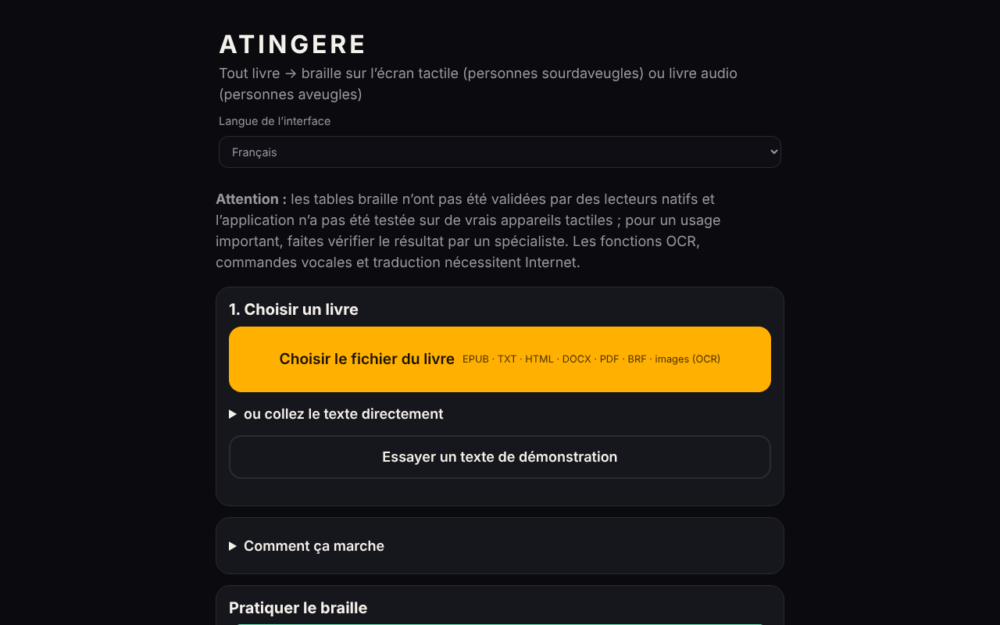

# ATINGERE

[English](README.md) · [Română](README.ro.md) · **Français** · [Italiano](README.it.md) · [Español](README.es.md) · [Português](README.pt.md) · [Deutsch](README.de.md) · [Magyar](README.hu.md)

**Version :** 1.2.1 · **Dernière mise à jour :** 2026-10-22

Langues de l'interface : **Română, English, Français, Italiano, Español, Português (PT), Deutsch, Magyar**

**En ligne / démo :** https://chiuta.github.io/ATINGERE/

Convertit n'importe quel livre (EPUB, TXT, HTML, DOCX, PDF, BRF, images) en braille tactile pour les personnes sourdaveugles ou en livre audio pour les personnes aveugles. Un seul fichier HTML, 137 langues et codes (braille de degré 1) ; les fonctions d'OCR, de commandes vocales et de traduction nécessitent Internet.

**N'importe quel livre, en braille tactile ou en livre audio — à partir d'un seul fichier HTML, sans compte, sans serveur.**

*Application web autonome, hors ligne, qui transforme un livre en braille sur écran tactile (vibration, pour les lecteurs sourdaveugles) ou en livre audio par synthèse vocale (pour les lecteurs aveugles). Plus de 130 langues, le roumain en premier.*

**Application en ligne :** il n'existe pour l'instant aucune adresse publique confirmée (GitHub Pages n'est pas activé ou l'adresse n'a pas été vérifiée lors de l'audit). Téléchargez `index.html` et ouvrez-le dans un navigateur ; les fonctions de base marchent hors ligne.

## Pour qui
- **Personnes sourdaveugles :** le livre devient du braille sur l'écran tactile. Chaque cellule compte 6 points ; les points en relief se ressentent par une vibration sous le doigt. Il existe aussi des vibrations automatiques, au rythme des cellules.
- **Personnes aveugles :** le livre devient un livre audio grâce à la synthèse vocale de l'appareil, avec reprise automatique, vitesse réglable et minuterie de sommeil.

## Ce qu'il fait
- **Formats d'entrée :** EPUB, TXT, HTML, DOCX, PDF (avec texte, hors ligne), BRF/BRL et textes braille Unicode, PDF numérisés et images PNG/JPG/WebP (par OCR).
- **Braille :** plus de 130 langues ; roumain étendu, avec un code propre. Degré 1 pour toutes, **degré 2** pour 10 langues (en, fr, de, pt, no, da, hu, ga, cy, ur) grâce à liblouis.
- **Lecture tactile :** cellule, mot, paragraphe, chapitre ; deux cellules côte à côte ; mode apprentissage avec tests ; écriture Perkins.
- **Outils :** signets, recherche, répétition du paragraphe, résumé extractif local, page de l'enseignant (texte + braille, avec bouton d'impression et style d'impression dédié), arrêt d'urgence (secousse, Échap), contraste élevé, texte agrandi, commandes vocales (en roumain).
- **Export :** `.brf` (40 × 25) et texte braille Unicode.
- **Catalogue :** sources gratuites de livres en roumain et dans d'autres langues, ainsi que des sources de livres déjà en braille.
- **Traduction automatique** vers le roumain (facultative, modèle téléchargé une fois, ~700 Mo).

## Ce qui nécessite Internet
L'OCR (le moteur et les données de langue sont téléchargés une fois), les commandes vocales (le service du navigateur) et la traduction automatique. Tout le reste fonctionne hors ligne.

## Limites — à lire avant un usage sérieux
(L'avertissement ci-dessous est aussi affiché sur le premier écran de l'application.)
- Les tables braille **n'ont pas été validées par des lecteurs de braille natifs** et l'application **n'a pas été testée sur de vrais appareils tactiles** (vibrations, écran) ni avec des lecteurs d'écran. Les tests automatiques vérifient la cohérence, pas que le texte soit correct pour le lecteur.
- Pour le chinois, le cantonais, le japonais et le coréen, le braille est obtenu de façon approximative, à partir de la prononciation ; certaines lectures peuvent être erronées.
- Le degré 2 provient de liblouis 3.2.0 (anciennes tables). Il n'existe pas de degré 2 normalisé pour le roumain ; le degré 1 est utilisé.
- L'iPhone/iPad ne permettent pas les vibrations depuis le navigateur. Utilisez Android + Chrome ou exportez en `.brf`.
- Les commandes vocales et l'OCR ont été vérifiés par des simulations, et non avec une vraie voix ou de vraies numérisations sur Internet.
- Non implémenté : afficheur braille matériel (WebHID), voix neuronale hors ligne, application installable (PWA).

## Rapports d'erreurs
Si un mot apparaît avec un braille erroné, utilisez dans l'application **⋯ → Signaler une erreur de braille**, puis joignez le fichier à une *Issue*. Le plus utile est le rapport d'un lecteur de braille natif, avec la langue, le mot et la forme correcte.

## Confidentialité
L'application n'a ni serveur propre, ni compte, ni statistiques, ni pistage ; les livres restent dans le navigateur, et la progression et les signets sont enregistrés localement. **Mais certaines fonctions facultatives contactent des tiers :**
- **OCR** (images/PDF numérisé) : à la première utilisation, il charge `tesseract.js` depuis `cdn.jsdelivr.net` (sans vérification d'intégrité SRI) et les données de langue depuis `raw.githubusercontent.com` ; ces serveurs voient l'adresse IP, pas le texte du livre.
- **Traduction automatique** (facultative) : charge `transformers.js` depuis `cdn.jsdelivr.net` et le modèle (~700 Mo) depuis `huggingface.co` ; la traduction s'exécute localement.
- **Commandes vocales** : elles utilisent la reconnaissance vocale du navigateur (`SpeechRecognition`) ; dans Chrome, par exemple, l'audio est envoyé au service vocal du fournisseur du navigateur.
- Les liens du catalogue de livres mènent à des sites externes, uniquement au clic.
Sans ces fonctions, l'application ne fait aucune requête réseau.

## Licence
Code propre : MIT (voir [LICENSE](LICENSE)). Les composants tiers (liblouis, pdf.js et d'autres) ont leurs propres licences ; voir [NOTICE.md](NOTICE.md). Certaines entrées y sont marquées « à vérifier » (la table des kanji dérivée de pykakasi, possiblement GPL-3.0 ; les tables chinois/cantonais dont la source n'est pas documentée ; le modèle NLLB-200, CC-BY-NC, téléchargé à la demande) et doivent être clarifiées par l'auteur avant que la licence MIT soit considérée comme définitive.

Audit : 2026-10-10 ; tour 2 (2026-10-11) : avertissement de validation sur le premier écran ; la licence MIT et NOTICE.md sont conservés inchangés (les conflits pykakasi/GPL, liblouis/LGPL et NLLB/CC-BY-NC restent à clarifier par l'auteur) ; le SRI pour les scripts jsDelivr n'a pas pu être ajouté (pas de réseau pour calculer les empreintes).

## Nouveautés (v1.1.0)

- **Étiquette de transparence** (clic sur `v 1.1.0 · 2026-10-14` dans le pied de page, kit commun) : indique quel stockage local l'application utilise (progression, signets, réglages) et que les fonctions de base ne font aucune requête réseau.
- **Sauvegarde `.fff.json`** de la progression de lecture, des signets et des réglages (export/import, éventuellement chiffrée par mot de passe ; les livres eux-mêmes ne sont pas inclus).
- **La conversion en braille, la lecture tactile et le livre audio sont inchangés** : par rapport à la 1.0.0, seuls le bloc du kit et la version ont été ajoutés. La CSP n'a pas été modifiée (elle reste sans `script-src`, pour les raisons de l'historique). Rien n'a été ajouté qui touche aux tables braille.
- Les nouveaux textes sont en ro, en, fr, it, es, pt, hu, de ; les traductions sont automatiques et non vérifiées par des locuteurs natifs.
- Tests : `tests/fff-r8.test.mjs` (réseau bloqué, 1280 et 360 px, axe 0 violation dans la nouvelle boîte de dialogue). Limite : l'application n'a pas été testée sur de vrais appareils tactiles, comme auparavant.

## Historique / Changelog

### 1.2.1 — 2026-10-22
- Le catalogue des sources de livres (noms, notes de prix et descriptions) et le titre de la page suivent désormais la langue de l'interface au lieu de rester en roumain.

### 1.1.1 — 2026-10-18
- Corrigé : la détection de la langue ne vote plus pour le catalan à chaque point médian « · » (utilisé dans les titres, p. ex. Nota Zero) ; seule la géminée « l·l » est conservée. Les fichiers .md roumains contenant « · » sont désormais reconnus comme `ro`.

### 1.1.0 — 2026-10-14
- Nouveau : étiquette de transparence et sauvegarde `.fff.json` (kit commun). Conversion en braille inchangée.

### 1.0.0 — 2026-10-12
- La version et la date de la dernière mise à jour sont affichées dans l'application (pied de page).

### 11 octobre 2026 (tour 7)
- Corrigé : l'export .BRF/.txt intercepte désormais les erreurs (message « L'export a échoué » au lieu d'un échec silencieux) et désactive les boutons pendant son exécution, afin de ne pas lancer deux téléchargements à la fois ; un échec de téléchargement n'a pas pu être reproduit dans Chromium (les téléchargements fonctionnent), la cause signalée reste donc non confirmée.
- Amélioré : l'avertissement du premier écran est court en roumain, avec la version anglaise (marquée `lang="en"`) dans un panneau « English » ; note sur l'encodage ASCII braille de l'export .BRF.
- Inchangé : pas de `script-src` dans la CSP et pas de SRI (liblouis/`new Function`, workers et WASM depuis jsDelivr ; ils ne peuvent pas être vérifiés sans réseau) ; les licences restent la décision de l'auteur.

### 11 octobre 2026 (tour 6)
- Ajouté : bouton « Imprimer » dans la page de l'enseignant, avec un style d'impression qui ne conserve que le braille et le texte du paragraphe ; respecte `prefers-reduced-motion` et `prefers-contrast: more`.
- Inchangé : pas de `script-src` dans la CSP (il faudrait `unsafe-eval` pour liblouis, des workers/WASM depuis jsDelivr pour l'OCR et la traduction, impossible à vérifier sans réseau).

### 11 octobre 2026
- Corrigé : les boutons d'export (.BRF et texte braille Unicode) sont maintenant visibles directement sur l'écran principal (étape 3), et non dans une section repliée.
- Corrigé : le champ de recherche de langue avait un fond blanc avec du texte clair (contraste insuffisant) ; les écrans Braille, Audio, Apprendre et Écrire ont maintenant un titre de niveau 1 (0 violation axe-core à 1280 et 360 px, y compris après le chargement d'un texte).
- Inchangé (décision de l'auteur) : les licences des composants pykakasi/NLLB/liblouis restent à clarifier ; `new Function` (chargement de liblouis) est conservé, nécessaire pour le braille de degré 2.
