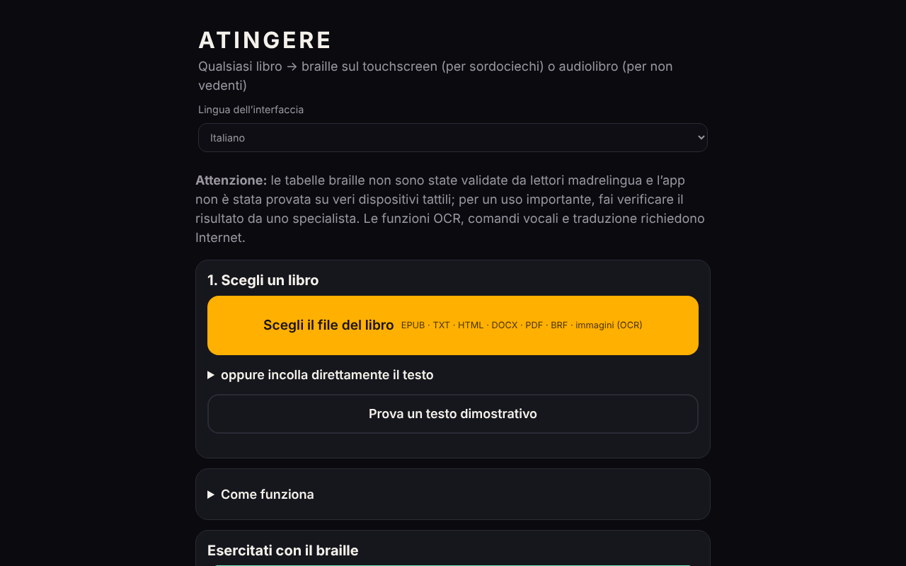

# ATINGERE

[English](README.md) · [Română](README.ro.md) · [Français](README.fr.md) · **Italiano** · [Español](README.es.md) · [Português](README.pt.md) · [Deutsch](README.de.md) · [Magyar](README.hu.md)

**Versione:** 1.2.4 · **Ultimo aggiornamento:** 2026-10-22

Lingue dell'interfaccia: **Română, English, Français, Italiano, Español, Português (PT), Deutsch, Magyar**

**Online / demo:** https://chiuta.github.io/ATINGERE/

Converte qualsiasi libro (EPUB, TXT, HTML, DOCX, PDF, BRF, immagini) in braille tattile per le persone sordocieche o in audiolibro per le persone non vedenti. Un unico file HTML, 137 lingue e codici (braille di grado 1); le funzioni OCR, i comandi vocali e la traduzione richiedono Internet.

**Qualsiasi libro, in braille tattile o in audiolibro — da un unico file HTML, senza account, senza server.**

*Applicazione web autonoma e offline che trasforma un libro in braille su touch screen (vibrazione, per i lettori sordociechi) o in audiolibro con sintesi vocale (per i lettori non vedenti). Oltre 130 lingue, prima il romeno.*

**Applicazione online:** al momento non esiste un indirizzo pubblico confermato (GitHub Pages non è attivato oppure l'indirizzo non è stato verificato durante l'audit). Scarica `index.html` e aprilo in un browser; le funzioni di base funzionano offline.

## Per chi è
- **Persone sordocieche:** il libro diventa braille sul touch screen. Ogni cella ha 6 punti; i punti in rilievo si percepiscono come vibrazione sotto il dito. Ci sono anche vibrazioni automatiche, al ritmo delle celle.
- **Persone non vedenti:** il libro diventa un audiolibro con la sintesi vocale del dispositivo, con ripresa automatica, velocità regolabile e timer di spegnimento.

## Che cosa fa
- **Formati di ingresso:** EPUB, TXT, HTML, DOCX, PDF (con testo, offline), BRF/BRL e testi braille Unicode, PDF scansionati e immagini PNG/JPG/WebP (tramite OCR).
- **Braille:** oltre 130 lingue; romeno esteso, con codice proprio. Grado 1 per tutte, **grado 2** per 10 lingue (en, fr, de, pt, no, da, hu, ga, cy, ur) tramite liblouis.
- **Lettura tattile:** cella, parola, paragrafo, capitolo; due celle affiancate; modalità di apprendimento con test; scrittura Perkins.
- **Strumenti:** segnalibri, ricerca, ripetizione del paragrafo, riassunto estrattivo locale, pagina dell'insegnante (testo + braille, con pulsante di stampa e stile di stampa dedicato), arresto di emergenza (scossa, Esc), contrasto elevato, testo ingrandito, comandi vocali (in romeno).
- **Esportazione:** `.brf` (40 × 25) e testo braille Unicode.
- **Catalogo:** fonti gratuite di libri in romeno e in altre lingue, più fonti di libri già in braille.
- **Traduzione automatica** in romeno (facoltativa, modello scaricato una volta, ~700 MB).

## Che cosa richiede Internet
L'OCR (il motore e i dati della lingua si scaricano una volta), i comandi vocali (il servizio del browser) e la traduzione automatica. Il resto funziona offline.

## Limiti — da leggere prima di un uso serio
(L'avvertenza qui sotto è mostrata anche nella prima schermata dell'applicazione.)
- Le tabelle braille **non sono state validate da lettori madrelingua di braille** e l'applicazione **non è stata testata su dispositivi tattili reali** (vibrazioni, schermo) né con screen reader. I test automatici verificano la coerenza, non che il testo sia corretto per il lettore.
- Per cinese, cantonese, giapponese e coreano il braille è ottenuto in modo approssimativo, dalla pronuncia; alcune letture possono essere errate.
- Il grado 2 proviene da liblouis 3.2.0 (tabelle vecchie). Per il romeno non esiste un grado 2 standardizzato; si usa il grado 1.
- iPhone/iPad non consentono le vibrazioni dal browser. Usa Android + Chrome oppure esporta in `.brf`.
- I comandi vocali e l'OCR sono stati verificati con simulazioni, non con voce o scansioni reali via Internet.
- Non implementato: display braille hardware (WebHID), voce neurale offline, app installabile (PWA).

## Segnalazione di errori
Se una parola compare con un braille errato, usa nell'app **⋯ → Segnala un errore di braille**, poi allega il file a una *Issue*. Il più utile è il rapporto di un lettore madrelingua di braille, con la lingua, la parola e la forma corretta.

## Privacy
L'applicazione non ha un server proprio, account, statistiche né tracciamento; i libri restano nel browser, e i progressi e i segnalibri vengono salvati in locale. **Ma alcune funzioni facoltative contattano terze parti:**
- **OCR** (immagini/PDF scansionato): al primo utilizzo carica `tesseract.js` da `cdn.jsdelivr.net` (senza verifica di integrità SRI) e i dati della lingua da `raw.githubusercontent.com`; questi server vedono l'indirizzo IP, non il testo del libro.
- **Traduzione automatica** (facoltativa): carica `transformers.js` da `cdn.jsdelivr.net` e il modello (~700 MB) da `huggingface.co`; la traduzione viene eseguita in locale.
- **Comandi vocali**: usano il riconoscimento vocale del browser (`SpeechRecognition`); in Chrome, ad esempio, l'audio viene inviato al servizio vocale del fornitore del browser.
- I link del catalogo dei libri portano a siti esterni, solo al clic.
Senza queste funzioni, l'applicazione non effettua richieste di rete.

## Licenza
Codice proprio: MIT (vedi [LICENSE](LICENSE)). I componenti di terze parti (liblouis, pdf.js e altri) hanno licenze proprie; vedi [NOTICE.md](NOTICE.md). Alcune voci sono contrassegnate «da verificare» (la tabella dei kanji derivata da pykakasi, possibilmente GPL-3.0; le tabelle cinese/cantonese con fonte non documentata; il modello NLLB-200, CC-BY-NC, scaricato su richiesta) e devono essere chiarite dall'autore prima che la licenza MIT sia considerata definitiva.

Audit: 2026-10-10; round 2 (2026-10-11): avviso di validazione nella prima schermata; la licenza MIT e NOTICE.md sono rimasti invariati (i conflitti pykakasi/GPL, liblouis/LGPL e NLLB/CC-BY-NC restano da chiarire da parte dell'autore); non è stato possibile aggiungere SRI per gli script jsDelivr (nessuna rete per calcolare gli hash).

## Novità (v1.1.0)

- 1.2.4 — 2026-10-22: fff-kit 1.1.2: PBKDF2 600.000 iterazioni, protezione anti-clickjacking
- **Etichetta di trasparenza** (clic su `v 1.1.0 · 2026-10-14` nel piè di pagina, kit comune): mostra quale archiviazione locale usa l'applicazione (progressi, segnalibri, impostazioni) e che le funzioni di base non effettuano richieste di rete.
- **Copia di sicurezza `.fff.json`** dei progressi di lettura, dei segnalibri e delle impostazioni (esportazione/importazione, facoltativamente cifrata con password; i libri stessi non sono inclusi).
- **La conversione in braille, la lettura tattile e l'audiolibro sono invariati**: rispetto alla 1.0.0 sono stati aggiunti solo il blocco del kit e la versione. La CSP non è stata modificata (resta senza `script-src`, per i motivi indicati nella cronologia). Non è stato aggiunto nulla che tocchi le tabelle braille.
- I nuovi testi sono in ro, en, fr, it, es, pt, hu, de; le traduzioni sono automatiche e non verificate da madrelingua.
- Test: `tests/fff-r8.test.mjs` (rete bloccata, 1280 e 360 px, axe 0 violazioni nella nuova finestra). Limite: l'applicazione non è stata testata su dispositivi tattili reali, come prima.

## Cronologia / Changelog

### 1.2.3 — 2026-10-22
- Accessibilità: un solo H1 per schermata (gli altri titoli sono H2 con lo stesso aspetto); il campo per incollare il testo ha ora un nome accessibile.
- Il passaggio «Segnala un errore braille» non usa più un prompt bloccante del browser: si apre una finestra di dialogo nell'app (tradotta nelle 8 lingue).
- Mobile: le didascalie piccole arrivano ad almeno 12 px; i link negli elenchi di fonti hanno un'area di tocco più grande.

### 1.2.2 — 2026-10-22
- rimosso l'avviso di validazione duplicato in inglese mostrato nell'interfaccia rumena (l'avviso in rumeno dice già lo stesso).

### 1.2.1 — 2026-10-22
- Il catalogo delle fonti di libri (nomi, note sui prezzi e descrizioni) e il titolo della pagina seguono ora la lingua dell'interfaccia invece di restare in rumeno.

### 1.1.1 — 2026-10-18
- Corretto: il rilevamento della lingua non vota più catalano per ogni punto mediano «·» (usato nei titoli, ad es. Nota Zero); resta solo la geminata «l·l». I file .md romeni con «·» sono ora riconosciuti come `ro`.

### 1.1.0 — 2026-10-14
- Nuovo: etichetta di trasparenza e copia di sicurezza `.fff.json` (kit comune). Conversione braille invariata.

### 1.0.0 — 2026-10-12
- La versione e la data dell'ultimo aggiornamento sono mostrate nell'app (piè di pagina).

### 11 ottobre 2026 (round 7)
- Corretto: l'esportazione .BRF/.txt ora intercetta gli errori (messaggio «Esportazione non riuscita» invece di un fallimento silenzioso) e disattiva i pulsanti mentre è in corso, per non avviare due download insieme; un fallimento del download non è stato riproducibile in Chromium (i download funzionano), quindi la causa segnalata resta non confermata.
- Migliorato: l'avviso della prima schermata è breve in romeno, con la versione inglese (marcata `lang="en"`) in un pannello «English»; nota sulla codifica ASCII braille dell'esportazione .BRF.
- Invariato: nessun `script-src` nella CSP e nessun SRI (liblouis/`new Function`, worker e WASM da jsDelivr; non verificabili senza rete); le licenze restano una decisione dell'autore.

### 11 ottobre 2026 (round 6)
- Aggiunto: pulsante «Stampa» nella pagina dell'insegnante, con uno stile di stampa che conserva solo il braille e il testo del paragrafo; rispetta `prefers-reduced-motion` e `prefers-contrast: more`.
- Invariato: nessun `script-src` nella CSP (servirebbe `unsafe-eval` per liblouis, worker/WASM da jsDelivr per OCR e traduzione, impossibile da verificare senza rete).

### 11 ottobre 2026
- Corretto: i pulsanti di esportazione (.BRF e testo braille Unicode) sono ora visibili direttamente nella schermata principale (passaggio 3), non in una sezione compressa.
- Corretto: il campo di ricerca della lingua aveva sfondo bianco con testo chiaro (contrasto insufficiente); le schermate Braille, Audio, Impara e Scrivi hanno ora un titolo di livello 1 (0 violazioni axe-core a 1280 e 360 px, anche dopo il caricamento di un testo).
- Invariato (decisione dell'autore): le licenze dei componenti pykakasi/NLLB/liblouis restano da chiarire; `new Function` (caricamento di liblouis) è mantenuto, necessario per il braille di grado 2.
