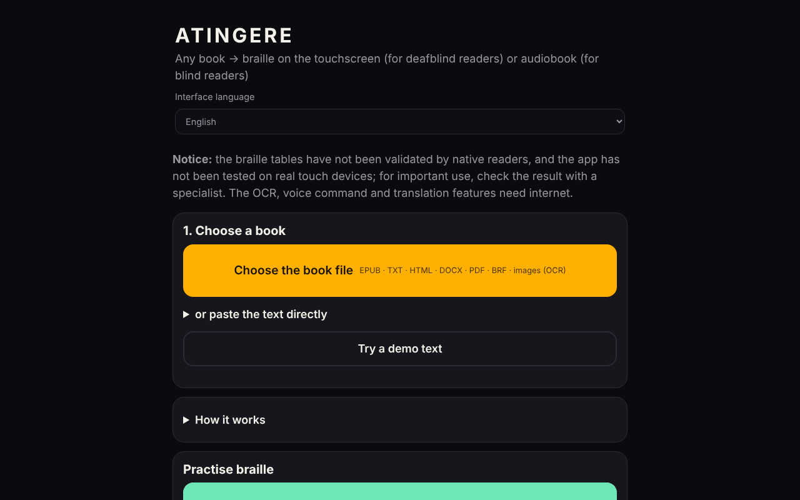

# ATINGERE

**English** · [Română](README.ro.md) · [Français](README.fr.md) · [Italiano](README.it.md) · [Español](README.es.md) · [Português](README.pt.md) · [Deutsch](README.de.md) · [Magyar](README.hu.md)

**Version:** 1.2.4 · **Last updated:** 2026-10-22

Interface languages: **Română, English, Français, Italiano, Español, Português (PT), Deutsch, Magyar**

**Live / demo:** https://chiuta.github.io/ATINGERE/

Converts any book (EPUB, TXT, HTML, DOCX, PDF, BRF, images) into tactile braille for deaf-blind people or into an audiobook for blind people. A single HTML file, 137 languages and codes (grade 1 braille); the OCR, voice commands and translation features need internet.

**Any book, as tactile braille or as an audiobook — from a single HTML file, with no account, no server.**

*One-file, offline web app that turns a book into touch-screen braille (vibration, for deaf-blind readers) or a TTS audiobook (for blind readers). 130+ languages, Romanian first.*

**Live app:** there is currently no confirmed public address (GitHub Pages is not enabled or the address was not verified during the audit). Download `index.html` and open it in a browser; the basic features work offline.

## Who it is for
- **Deaf-blind people:** the book becomes braille on the touch screen. Each cell has 6 dots; the raised dots are felt as vibration under the finger. There are also automatic vibrations, at the rhythm of the cells.
- **Blind people:** the book becomes an audiobook using the device's speech synthesis, with automatic resume, adjustable speed and a sleep timer.

## What it does
- **Input formats:** EPUB, TXT, HTML, DOCX, PDF (with text, offline), BRF/BRL and Unicode braille texts, scanned PDFs and PNG/JPG/WebP images (via OCR).
- **Braille:** over 130 languages; extended Romanian, with its own code. Grade 1 for all, **grade 2** for 10 languages (en, fr, de, pt, no, da, hu, ga, cy, ur) through liblouis.
- **Tactile reading:** cell, word, paragraph, chapter; two adjacent cells; learning mode with tests; Perkins writing.
- **Tools:** bookmarks, search, paragraph repeat, local extractive summary, the teacher page (text + braille, with a print button and a dedicated print style), emergency stop (shaking, Esc), high contrast, enlarged text, voice commands (in Romanian).
- **Export:** `.brf` (40 × 25) and Unicode braille text.
- **Catalogue:** free sources of books in Romanian and other languages, plus sources of books already in braille.
- **Automatic translation** into Romanian (optional, model downloaded once, ~700 MB).

## What needs internet
OCR (the engine and the language data are downloaded once), voice commands (the browser's service) and automatic translation. Everything else works offline.

## Limits — read before serious use
(The warning below is also shown on the app's first screen.)
- The braille tables **have not been validated by native braille readers** and the app **has not been tested on real touch devices** (vibration, screen) or with screen readers. The automated tests check consistency, not whether the text is correct for the reader.
- For Chinese, Cantonese, Japanese and Korean the braille is obtained approximately, from pronunciation; some readings may be wrong.
- Grade 2 comes from liblouis 3.2.0 (old tables). There is no standardized grade 2 for Romanian; grade 1 is used.
- iPhone/iPad do not allow vibration from the browser. Use Android + Chrome or export `.brf`.
- Voice commands and OCR were verified with simulations, not with real voice or scans over the internet.
- Not implemented: hardware braille display (WebHID), offline neural voice, installable app (PWA).

## Error reports
If a word appears with wrong braille, use **⋯ → Report a braille error** in the app, then attach the file to an *Issue*. The most useful report is one from a native braille reader, with the language, the word and the correct form.

## Privacy
The app has no server of its own, no account, no statistics or tracking; books stay in the browser, and progress and bookmarks are saved locally. **But some optional features contact third parties:**
- **OCR** (images/scanned PDF): on first use it loads `tesseract.js` from `cdn.jsdelivr.net` (without an SRI integrity check) and the language data from `raw.githubusercontent.com`; these servers see the IP address, not the book's text.
- **Automatic translation** (optional): loads `transformers.js` from `cdn.jsdelivr.net` and the model (~700 MB) from `huggingface.co`; the translation runs locally.
- **Voice commands**: they use the browser's speech recognition (`SpeechRecognition`); in Chrome, for example, the audio is sent to the browser vendor's voice service.
- The links in the book catalogue lead to external sites, only on click.
Without these features, the app makes no network requests.

## License
Own code: MIT (see [LICENSE](LICENSE)). The third-party components (liblouis, pdf.js and others) have their own licenses; see [NOTICE.md](NOTICE.md). Some entries there are marked "to be verified" (the kanji table derived from pykakasi, possibly GPL-3.0; the Chinese/Cantonese tables with undocumented source; the NLLB-200 model, CC-BY-NC, downloaded on request) and must be clarified by the author before the MIT license is considered final.

Audit: 2026-10-10; round 2 (2026-10-11): validation warning on the first screen; the MIT license and NOTICE.md kept unchanged (the pykakasi/GPL, liblouis/LGPL and NLLB/CC-BY-NC conflicts remain to be clarified by the author); SRI for the jsDelivr scripts could not be added (no network for computing the hashes).

## New features (v1.1.0)

- **Transparency label** (click `v 1.1.0 · 2026-10-14` in the footer, shared kit): shows what local storage the app uses (progress, bookmarks, settings) and that the basic features make no network requests.
- **`.fff.json` backup** of reading progress, bookmarks and settings (export/import, optionally encrypted with a password; the books themselves are not included).
- **Braille conversion, tactile reading and the audiobook are unchanged**: compared with 1.0.0, only the kit block and the version were added. The CSP was not modified (it remains without `script-src`, for the reasons in the history). Nothing that touches the braille tables was added.
- The new texts are in ro, en, fr, it, es, pt, hu, de; the translations are machine-generated and not checked by native speakers.
- Tests: `tests/fff-r8.test.mjs` (network blocked, 1280 and 360 px, axe 0 violations in the new dialog). Limitation: the app has not been tested on real touch devices, as before.

## History / Changelog

### 1.2.4 — 2026-10-22
- fff-kit 1.1.2: PBKDF2 600,000 iterations, anti-clickjacking protection

### 1.2.3 — 2026-10-22
- Accessibility: a single H1 per screen (the other titles are H2 with the same look); the paste-text field now has an accessible name.
- The "Report a braille mistake" step no longer uses a blocking browser prompt: it opens an in-app dialog (translated into all 8 languages).
- Mobile: small captions raised to at least 12 px; links in the source lists have a larger tap area.

### 1.2.2 — 2026-10-22
- removed the duplicate English validation notice that was shown under the Romanian interface (the Romanian notice already says the same).

### 1.2.1 — 2026-10-22
- The catalog of book sources (names, price notes and descriptions) and the page title now follow the interface language instead of staying Romanian.

### 1.1.1 — 2026-10-18
- Fixed: language detection no longer votes Catalan for any middle dot "·" (used in titles, e.g. Nota Zero); only the geminate "l·l" remains. Romanian .md files containing "·" are now recognized as `ro`.

### 1.1.0 — 2026-10-14
- New: transparency label and `.fff.json` backup (shared kit). Braille conversion unchanged.

### 1.0.0 — 2026-10-12
- The version and the date of the last update are shown in the app (footer).

### 11 October 2026 (round 7)
- Fixed: the .BRF/.txt export now catches errors ("Export failed" message instead of a silent failure) and disables the buttons while it runs, so that two downloads do not start at once; a download failure could not be reproduced in Chromium (downloads work), so the reported cause remains unconfirmed.
- Improved: the warning on the first screen is short in Romanian, with the English version (marked `lang="en"`) in an "English" panel; a note about the ASCII braille encoding of the .BRF export.
- Unchanged: no `script-src` in the CSP and no SRI (liblouis/`new Function`, workers and WASM from jsDelivr; they cannot be verified without a network); the licenses remain the author's decision.

### 11 October 2026 (round 6)
- Added: a "Print" button on the teacher page, with a print style that keeps only the braille and the paragraph text; it respects `prefers-reduced-motion` and `prefers-contrast: more`.
- Unchanged: no `script-src` in the CSP (it would need `unsafe-eval` for liblouis, workers/WASM from jsDelivr for OCR and translation, impossible to verify without a network).

### 11 October 2026
- Fixed: the export buttons (.BRF and Unicode braille text) are now visible directly on the main screen (step 3), not in a collapsed section.
- Fixed: the language search field had a white background with light text (insufficient contrast); the Braille, Audio, Learn and Write screens now have a level-1 heading (0 axe-core violations at 1280 and 360 px, including after loading a text).
- Unchanged (the author's decision): the licenses of the pykakasi/NLLB/liblouis components remain to be clarified; `new Function` (loading liblouis) is kept, needed for grade 2 braille.
