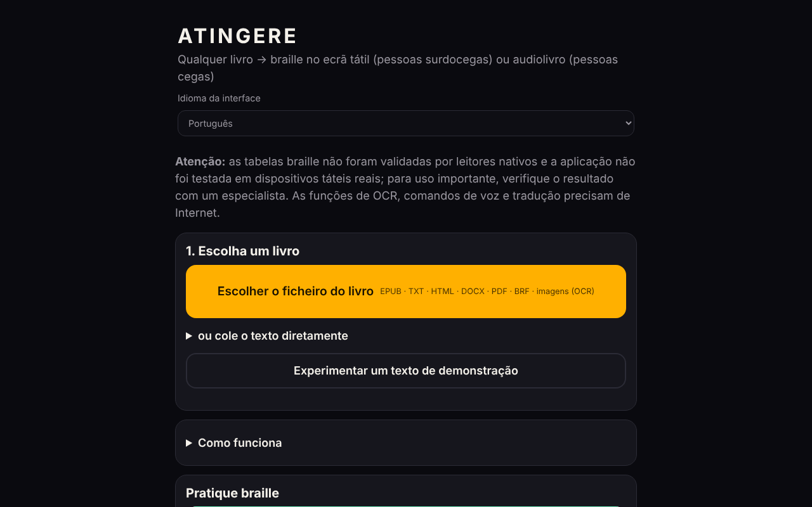

# ATINGERE

[English](README.md) · [Română](README.ro.md) · [Français](README.fr.md) · [Italiano](README.it.md) · [Español](README.es.md) · **Português** · [Deutsch](README.de.md) · [Magyar](README.hu.md)

**Versão:** 1.4.0 · **Última atualização:** 2026-10-27

**Estado:** experimental · **Offline:** completo para as funções básicas; requer Internet para os dados de idioma do OCR, os comandos de voz e a tradução automática

Idiomas da interface: **Română, English, Français, Italiano, Español, Português (PT), Deutsch, Magyar**

**Online / demonstração:** https://chiuta.github.io/ATINGERE/

Converte qualquer livro (EPUB, TXT, HTML, DOCX, PDF, BRF, imagens) em braille tátil para pessoas surdocegas ou em audiolivro para pessoas cegas. Um único ficheiro HTML, 137 idiomas e códigos (braille de grau 1); as funcionalidades de OCR, comandos de voz e tradução precisam de internet.

**Qualquer livro, em braille tátil ou em audiolivro — a partir de um único ficheiro HTML, sem conta, sem servidor.**

*Aplicação web autónoma e offline que transforma um livro em braille no ecrã tátil (vibração, para leitores surdocegos) ou em audiolivro com síntese de voz (para leitores cegos). Mais de 130 idiomas, o romeno primeiro.*

**Aplicação online:** neste momento não existe um endereço público confirmado (o GitHub Pages não está ativado ou o endereço não foi verificado na auditoria). Descarregue `index.html` e abra-o num navegador; as funcionalidades básicas funcionam offline.

## Para quem
- **Pessoas surdocegas:** o livro torna-se braille no ecrã tátil. Cada célula tem 6 pontos; os pontos em relevo sentem-se como vibração sob o dedo. Existem também vibrações automáticas, ao ritmo das células.
- **Pessoas cegas:** o livro torna-se um audiolivro com a síntese de voz do dispositivo, com retoma automática, velocidade ajustável e temporizador de sono.

## O que faz
- **Formatos de entrada:** EPUB, TXT, HTML, DOCX, PDF (com texto, offline), BRF/BRL e textos braille Unicode, PDF digitalizados e imagens PNG/JPG/WebP (através de OCR).
- **Braille:** mais de 130 idiomas; romeno alargado, com código próprio. Grau 1 para todos, **grau 2** para 10 idiomas (en, fr, de, pt, no, da, hu, ga, cy, ur) através do liblouis.
- **Leitura tátil:** célula, palavra, parágrafo, capítulo; duas células contíguas; modo de aprendizagem com testes; escrita Perkins.
- **Ferramentas:** marcadores, pesquisa, repetição do parágrafo, resumo extrativo local, página do professor (texto + braille, com botão de impressão e estilo de impressão próprio), paragem de emergência (abanão, Esc), contraste elevado, texto ampliado, comandos de voz (em romeno).
- **Exportação:** `.brf` (40 × 25) e texto braille Unicode.
- **Catálogo:** fontes gratuitas de livros em romeno e noutros idiomas, além de fontes de livros já em braille.
- **Tradução automática** para romeno (opcional, modelo descarregado uma vez, ~700 MB).

## O que precisa de internet
O OCR (os dados do idioma são descarregados uma vez; o motor está incluído), os comandos de voz (o serviço do navegador) e a tradução automática. Tudo o resto funciona offline.

## Limites — leia antes de uma utilização séria
(O aviso abaixo é também apresentado no primeiro ecrã da aplicação.)
- As tabelas braille **não foram validadas por leitores nativos de braille** e a aplicação **não foi testada em dispositivos táteis reais** (vibrações, ecrã) nem com leitores de ecrã. Os testes automáticos verificam a coerência, não que o texto esteja correto para o leitor.
- Para chinês, cantonês, japonês e coreano o braille é obtido de forma aproximada, a partir da pronúncia; algumas leituras podem estar erradas.
- O grau 2 vem do liblouis 3.2.0 (tabelas antigas). Para o romeno não existe um grau 2 normalizado; usa-se o grau 1.
- O iPhone/iPad não permitem vibrações a partir do navegador. Use Android + Chrome ou exporte `.brf`.
- Os comandos de voz e o OCR foram verificados com simulações, não com voz ou digitalizações reais pela internet.
- Não implementado: linha braille de hardware (WebHID), voz neuronal offline, aplicação instalável (PWA).

## Relatórios de erros
Se uma palavra surgir com braille errado, use na aplicação **⋯ → Comunicar um erro de braille** e anexe depois o ficheiro a uma *Issue*. O mais útil é o relatório de um leitor nativo de braille, com o idioma, a palavra e a forma correta.

## Privacidade
A aplicação não tem servidor próprio, conta, estatísticas nem rastreamento; os livros ficam no navegador, e o progresso e os marcadores são guardados localmente. **Mas algumas funcionalidades opcionais contactam terceiros:**
- **OCR** (imagens/PDF digitalizado): o motor (`tesseract.js`) faz parte do repositório (`vendor/`, carregado com SRI); na primeira utilização de um idioma, os seus dados são descarregados de `raw.githubusercontent.com` (commit fixo, SHA-256 verificado antes de usar); esse servidor vê o endereço IP, não o texto do livro.
- **Tradução automática** (opcional): a biblioteca (`transformers.js`) está em `vendor/`; o `.wasm` do ONNX Runtime (~22 MB) é descarregado de um caminho exato de `cdn.jsdelivr.net` (versão fixa, SHA-256 verificado, caso contrário é recusado) e o modelo (~700 MB) de `huggingface.co`; a tradução corre localmente.
- **Comandos de voz**: usam o reconhecimento de voz do navegador (`SpeechRecognition`); no Chrome, por exemplo, o áudio é enviado ao serviço de voz do fornecedor do navegador.
- As ligações do catálogo de livros levam a sítios externos, apenas ao clicar.
Sem estas funcionalidades, a aplicação não faz pedidos de rede.

## Licença
Código próprio: MIT (consulte [LICENSE](LICENSE)). Os componentes de terceiros (liblouis, pdf.js e outros) têm licenças próprias; consulte [NOTICE.md](NOTICE.md). Algumas entradas aí estão marcadas «a verificar» (a tabela de kanji derivada do pykakasi, possivelmente GPL-3.0; as tabelas de chinês/cantonês com fonte não documentada; o modelo NLLB-200, CC-BY-NC, descarregado a pedido) e têm de ser esclarecidas pelo autor antes de a licença MIT ser considerada definitiva.

**Estado das licenças (em esclarecimento).** A tabela kanji → hiragana (japonês) deriva do pykakasi (GPL-3.0) e a fonte das tabelas pinyin (chinês) e jyutping (cantonês) não está documentada; a compatibilidade com a licença MIT ainda não está estabelecida e **a licença não foi alterada**. Até lá, essas tabelas podem ser desativadas nas Definições (o resto da aplicação, incluindo kana e hangul, não é afetado). Opções para o autor: (1) licenciar todo o projeto sob GPL-3.0; (2) substituir as tabelas por dados permissivos ou de domínio público (p. ex. CC0 / derivados do Unicode Unihan, com fonte documentada); (3) retirar os idiomas afetados.

Auditoria: 2026-10-10; ronda 2 (2026-10-11): aviso de validação no primeiro ecrã; a licença MIT e o NOTICE.md mantidos sem alterações (os conflitos pykakasi/GPL, liblouis/LGPL e NLLB/CC-BY-NC continuam por esclarecer pelo autor); não foi possível acrescentar SRI aos scripts do jsDelivr (sem rede para calcular os hashes).

## Novidades (v1.1.0)

- **Etiqueta de transparência** (clique em `v 1.1.0 · 2026-10-14` no rodapé, kit comum): mostra que armazenamento local a aplicação usa (progresso, marcadores, definições) e que as funcionalidades básicas não fazem pedidos de rede.
- **Cópia de segurança `.fff.json`** do progresso de leitura, dos marcadores e das definições (exportação/importação, opcionalmente cifrada com palavra-passe; os livros em si não estão incluídos).
- **A conversão em braille, a leitura tátil e o audiolivro mantêm-se**: em relação à 1.0.0 foram acrescentados apenas o bloco do kit e a versão. A CSP não foi modificada (continua sem `script-src`, pelas razões do histórico). Não foi acrescentado nada que toque nas tabelas braille.
- Os textos novos estão em ro, en, fr, it, es, pt, hu, de; as traduções são automáticas e não verificadas por falantes nativos.
- Testes: `tests/fff-r8.test.mjs` (rede bloqueada, 1280 e 360 px, axe 0 violações na nova caixa de diálogo). Limitação: a aplicação não foi testada em dispositivos táteis reais, como antes.

## Histórico / Changelog

### 1.2.7 — 2026-10-22
- Segurança: já não se carrega nenhum código de um CDN em tempo de execução. O `tesseract.js` 5.1.1 (com `tesseract.js-core` 5.1.0, build SIMD) e o `transformers.js` 3.8.1 estão agora em `vendor/` (carregados da mesma origem com SRI e pré-colocados em cache pelo service worker). Os dados de idioma do OCR vêm de um commit fixo do `tessdata_fast` e o `.wasm` do ONNX Runtime de um caminho npm fixo; ambos são verificados com SHA-256 antes de usar (caso contrário são recusados). CSP: `cdn.jsdelivr.net` removido de `script-src`, `connect-src` limitado a caminhos exatos. Cerca de 5 MB adicionados ao repositório (ver `NOTICE.md`).
- O OCR exige WebAssembly SIMD; a partir de `file://` as bibliotecas de OCR e de tradução não podem ser carregadas (use https ou um servidor local).

### 1.2.6 — 2026-10-22
- fff-kit 1.1.4: alvos de toque e tamanho mínimo do texto; alvos de toque/texto corrigidos

### 1.2.5 — 2026-10-22
- Segurança: Content-Security-Policy completa (`default-src 'none'`; scripts só com hashes e de `cdn.jsdelivr.net`; ligações só a `cdn.jsdelivr.net`, `raw.githubusercontent.com` e `huggingface.co`/`hf.co`). Mantêm-se `'unsafe-eval'`, necessário para o liblouis (grau 2), e `blob:`, necessário para o pdf.js incorporado. Verificado: grau 2, PDF, OCR e bloqueio de anfitriões não listados.
- Transparência: os anfitriões externos declarados correspondem agora aos reais (faltavam `raw.githubusercontent.com` para os dados de idioma do OCR e `huggingface.co` para o modelo de tradução).
- Licenças: nova opção nas Definições que desativa as tabelas de leitura de chinês, cantonês e japonês (kanji), e uma nota «Licenças e situação jurídica» na aplicação (traduzida em 8 idiomas). Estado: **em esclarecimento** pelo autor, ver abaixo.

### 1.2.4 — 2026-10-22
- fff-kit 1.1.2: PBKDF2 600 000 iterações, proteção anti-clickjacking

### 1.2.3 — 2026-10-22
- Acessibilidade: um único H1 por ecrã (os restantes títulos são H2 com o mesmo aspeto); o campo para colar o texto tem agora um nome acessível.
- O passo «Comunicar um erro de braille» já não usa um aviso bloqueante do navegador: abre-se uma caixa de diálogo na aplicação (traduzida nos 8 idiomas).
- Telemóvel: as legendas pequenas passam a um mínimo de 12 px; as ligações nas listas de fontes têm uma área de toque maior.

### 1.2.2 — 2026-10-22
- removido o aviso de validação duplicado em inglês que aparecia na interface romena (o aviso em romeno já diz o mesmo).

### 1.2.1 — 2026-10-22
- O catálogo de fontes de livros (nomes, notas de preço e descrições) e o título da página acompanham agora o idioma da interface, em vez de ficarem em romeno.

### 1.1.1 — 2026-10-18
- Corrigido: a deteção de idioma já não vota catalão por qualquer ponto médio «·» (usado em títulos, p. ex. Nota Zero); mantém-se apenas a geminada «l·l». Os ficheiros .md romenos com «·» passam a ser reconhecidos como `ro`.

### 1.1.0 — 2026-10-14
- Novo: etiqueta de transparência e cópia de segurança `.fff.json` (kit comum). Conversão em braille inalterada.

### 1.0.0 — 2026-10-12
- A versão e a data da última atualização são apresentadas na aplicação (rodapé).

### 11 de outubro de 2026 (ronda 7)
- Corrigido: a exportação .BRF/.txt passa a capturar erros (mensagem «A exportação falhou» em vez de uma falha silenciosa) e desativa os botões enquanto decorre, para não iniciar duas transferências em simultâneo; não foi possível reproduzir uma falha de transferência no Chromium (as transferências funcionam), pelo que a causa reportada continua por confirmar.
- Melhorado: o aviso do primeiro ecrã é curto em romeno, com a versão inglesa (marcada `lang="en"`) num painel «English»; nota sobre a codificação ASCII braille da exportação .BRF.
- Inalterado: sem `script-src` na CSP e sem SRI (liblouis/`new Function`, workers e WASM do jsDelivr; não podem ser verificados sem rede); as licenças continuam a ser decisão do autor.

### 11 de outubro de 2026 (ronda 6)
- Acrescentado: botão «Imprimir» na página do professor, com um estilo de impressão que mantém apenas o braille e o texto do parágrafo; respeita `prefers-reduced-motion` e `prefers-contrast: more`.
- Inalterado: sem `script-src` na CSP (exigiria `unsafe-eval` para o liblouis, workers/WASM do jsDelivr para OCR e tradução, impossível de verificar sem rede).

### 11 de outubro de 2026
- Corrigido: os botões de exportação (.BRF e texto braille Unicode) estão agora visíveis diretamente no ecrã principal (passo 3), e não numa secção recolhida.
- Corrigido: o campo de pesquisa de idioma tinha fundo branco com texto claro (contraste insuficiente); os ecrãs Braille, Áudio, Aprender e Escrever têm agora um título de nível 1 (0 violações axe-core a 1280 e 360 px, inclusive após carregar um texto).
- Inalterado (decisão do autor): as licenças dos componentes pykakasi/NLLB/liblouis continuam por esclarecer; mantém-se `new Function` (carregamento do liblouis), necessário para o braille de grau 2.
