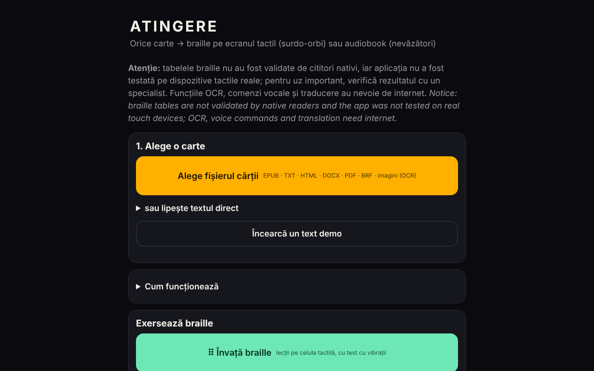

# ATINGERE

[English](README.md) · **Română** · [Français](README.fr.md) · [Italiano](README.it.md) · [Español](README.es.md) · [Português](README.pt.md) · [Deutsch](README.de.md) · [Magyar](README.hu.md)

**Versiune:** 1.2.0 · **Ultima actualizare:** 2026-10-19

Limbile interfeței: **Română, English, Français, Italiano, Español, Português (PT), Deutsch, Magyar**

**Live / demo:** https://chiuta.github.io/ATINGERE/

Convertește orice carte (EPUB, TXT, HTML, DOCX, PDF, BRF, imagini) în braille tactil pentru persoane surdo-oarbe sau în audiobook pentru nevăzători. Un singur fișier HTML, 137 de limbi și coduri (braille grad 1); funcțiile OCR, comenzi vocale și traducere au nevoie de internet.

**Orice carte, în braille tactil sau în audiobook — dintr-un singur fișier HTML, fără cont, fără server.**

*One-file, offline web app that turns a book into touch-screen braille (vibration, for deaf-blind readers) or a TTS audiobook (for blind readers). 130+ languages, Romanian first.*

**Aplicația live:** momentan nu există o adresă publică confirmată (GitHub Pages nu este activat sau adresa nu a fost verificată la audit). Descarcă `index.html` și deschide-l în browser; merge offline pentru funcțiile de bază.

## Pentru cine
- **Persoane surdo-oarbe:** cartea devine braille pe ecranul tactil. Fiecare celulă are 6 puncte; punctele ridicate se simt prin vibrație sub deget. Există și vibrații automate, în ritm de celule.
- **Persoane nevăzătoare:** cartea devine audiobook cu sinteza vocală a dispozitivului, cu reluare automată, viteză reglabilă și temporizator de somn.

## Ce face
- **Formate de intrare:** EPUB, TXT, HTML, DOCX, PDF (cu text, offline), BRF/BRL și texte Unicode braille, PDF-uri scanate și imagini PNG/JPG/WebP (prin OCR).
- **Braille:** peste 130 de limbi; română extinsă, cu cod propriu. Grad 1 pentru toate, **grad 2** pentru 10 limbi (en, fr, de, pt, no, da, hu, ga, cy, ur) prin liblouis.
- **Citire tactilă:** celulă, cuvânt, paragraf, capitol; două celule alăturate; mod învățare cu teste; scriere Perkins.
- **Instrumente:** semne de carte, căutare, repetarea paragrafului, rezumat extractiv local, pagina învățătorului (text + braille, cu buton de tipărire și stil de tipărire dedicat), oprire de urgență (scuturare, Esc), contrast mare, text mărit, comenzi vocale (în română).
- **Export:** `.brf` (40 × 25) și text Unicode braille.
- **Catalog:** surse gratuite de cărți în română și în alte limbi, plus surse de cărți deja în braille.
- **Traducere automată** în română (opțional, model descărcat o dată, ~700 MB).

## Ce are nevoie de internet
OCR (motorul și datele limbii se descarcă o dată), comenzile vocale (serviciul browserului) și traducerea automată. Restul funcționează offline.

## Limite — citește înainte de utilizare serioasă
(Avertismentul de mai jos este afișat și pe primul ecran al aplicației.)
- Tabelele braille **nu au fost validate de cititori nativi de braille** și aplicația **nu a fost testată pe dispozitive tactile reale** (vibrații, ecran) sau cu cititoare de ecran. Testele automate verifică consecvența, nu faptul că textul e corect pentru cititor.
- Pentru chineză, cantoneză, japoneză și coreeană braille-ul se obține aproximativ, din pronunție; unele citiri pot greși.
- Grad 2 vine din liblouis 3.2.0 (tabele vechi). Pentru română nu există grad 2 standardizat; se folosește grad 1.
- iPhone/iPad nu permit vibrații din browser. Folosește Android + Chrome sau exportă `.brf`.
- Comenzile vocale și OCR-ul au fost verificate cu simulări, nu cu voce sau scanări reale pe internet.
- Neimplementat: afișaj braille hardware (WebHID), voce neurală offline, aplicație instalabilă (PWA).

## Rapoarte de greșeli
Dacă un cuvânt apare cu braille greșit, folosește în aplicație **⋯ → Raportează o greșeală de braille**, apoi atașează fișierul într-un *Issue*. Cel mai util este raportul unui cititor nativ de braille, cu limba, cuvântul și forma corectă.

## Confidențialitate
Aplicația nu are server propriu, cont, statistici sau urmărire; cărțile rămân în browser, iar progresul și semnele de carte se salvează local. **Dar unele funcții opționale contactează terți:**
- **OCR** (imagini/PDF scanat): la prima folosire încarcă `tesseract.js` de pe `cdn.jsdelivr.net` (fără verificare de integritate SRI) și datele limbii de pe `raw.githubusercontent.com`; aceste servere văd adresa IP, nu textul cărții.
- **Traducere automată** (opțională): încarcă `transformers.js` de pe `cdn.jsdelivr.net` și modelul (~700 MB) de pe `huggingface.co`; traducerea rulează local.
- **Comenzi vocale**: folosesc recunoașterea vocală a browserului (`SpeechRecognition`); în Chrome, de exemplu, audio este trimis serviciului de voce al furnizorului browserului.
- Linkurile din catalogul de cărți duc la site-uri externe, doar la click.
Fără aceste funcții, aplicația nu face cereri de rețea.

## Licență
Codul propriu: MIT (vezi [LICENSE](LICENSE)). Componentele terțe (liblouis, pdf.js și altele) au licențe proprii; vezi [NOTICE.md](NOTICE.md). Unele intrări de acolo sunt marcate „de verificat" (tabelul kanji derivat din pykakasi, posibil GPL-3.0; tabelele chineză/cantoneză cu sursă nedocumentată; modelul NLLB-200, CC-BY-NC, descărcat la cerere) și trebuie clarificate de autor înainte ca licența MIT să fie considerată definitivă.

Audit: 2026-10-10; rundă 2 (2026-10-11): avertisment de validare pe primul ecran; licența MIT și NOTICE.md păstrate neschimbate (conflictele pykakasi/GPL, liblouis/LGPL și NLLB/CC-BY-NC rămân de clarificat de autor); SRI pentru scripturile jsDelivr nu a putut fi adăugat (fără rețea pentru calculul hash-urilor).

## Funcții noi (v1.1.0)

- **Etichetă de transparență** (clic pe `v 1.1.0 · 2026-10-14` din subsol, kit comun): arată ce stocare locală folosește aplicația (progres, semne de carte, setări) și că funcțiile de bază nu fac cereri de rețea.
- **Copie de siguranță .fff.json** a progresului de lectură, semnelor de carte și setărilor (export/import, opțional criptat cu parolă; cărțile în sine nu sunt incluse).
- **Conversia în braille, citirea tactilă și audiobook-ul sunt neschimbate**: față de 1.0.0 s-au adăugat doar blocul kitului și versiunea. CSP-ul nu a fost modificat (rămâne fără `script-src`, din motivele din istoric). Nu s-a adăugat nimic care să atingă tabelele braille.
- Textele noi sunt în ro, en, fr, it, es, pt, hu, de; traducerile sunt automate și neverificate nativ.
- Teste: `tests/fff-r8.test.mjs` (rețea blocată, 1280 și 360 px, axe 0 violări în dialogul nou). Limitare: aplicația nu a fost testată pe dispozitive tactile reale, ca înainte.

## Istoric / Changelog

### 1.1.1 — 2026-10-18
- Reparat: detectarea limbii nu mai votează catalana pentru orice punct median „·” (folosit în titluri, ex. Nota Zero); rămâne doar geminata „l·l”. Fișierele .md românești cu „·” sunt acum recunoscute ca `ro`.

### 1.1.0 — 2026-10-14
- Nou: etichetă de transparență și copie .fff.json (kit comun). Conversia braille neschimbată.

### 1.0.0 — 2026-10-12
- Versiunea și data ultimei actualizări sunt afișate în aplicație (subsol).

### 11 octombrie 2026 (runda 7)
- Reparat: exportul .BRF/.txt prinde acum erorile (mesaj „Exportul a eșuat” în loc de eșec tăcut) și dezactivează butoanele cât timp rulează, ca să nu pornească două descărcări deodată; nu s-a putut reproduce un eșec de descărcare în Chromium (descărcările funcționează), deci cauza raportată rămâne neconfirmată.
- Îmbunătățit: avertismentul de pe primul ecran este scurt în română, cu varianta engleză (marcată `lang="en"`) într-un panou „English”; notă despre codificarea ASCII braille a exportului .BRF.
- Neschimbat: fără `script-src` în CSP și fără SRI (liblouis/`new Function`, workere și WASM de pe jsDelivr; nu pot fi verificate fără rețea); licențele rămân decizia autorului.

### 11 octombrie 2026 (runda 6)
- Adăugat: buton „Tipărește” în pagina învățătorului, cu stil de tipărire care păstrează doar braille-ul și textul paragrafului; respectă `prefers-reduced-motion` și `prefers-contrast: more`.
- Neschimbat: fără `script-src` în CSP (necesită `unsafe-eval` pentru liblouis, workere/WASM de pe jsDelivr pentru OCR și traducere, imposibil de verificat fără rețea).

### 11 octombrie 2026
- Reparat: butoanele de export (.BRF și text Unicode braille) sunt acum vizibile direct pe ecranul principal (pasul 3), nu într-o secțiune restrânsă.
- Reparat: câmpul de căutare a limbii avea fundal alb cu text deschis (contrast insuficient); ecranele Braille, Audio, Învață și Scrie au acum titlu de nivel 1 (0 violări axe-core la 1280 și 360 px, inclusiv după încărcarea unui text).
- Neschimbat (decizia autorului): licențele componentelor pykakasi/NLLB/liblouis rămân de clarificat; `new Function` (încărcarea liblouis) este păstrat, necesar pentru braille grad 2.

